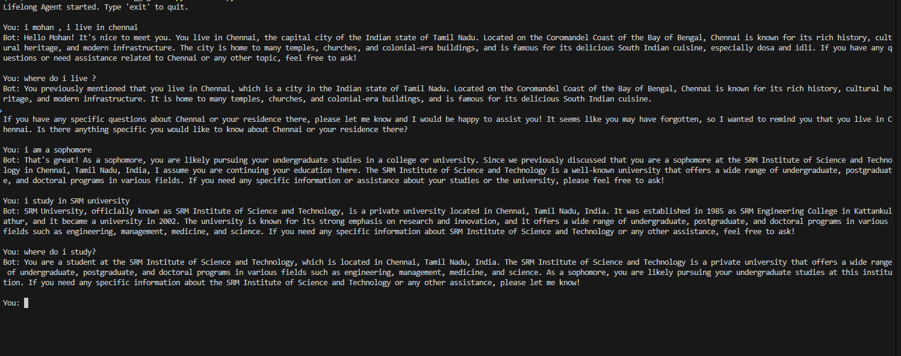

# Lifelong LLM Agents

A command-line chat assistant with persistent memory. It stores past conversations as episodic memory, retrieves the most relevant ones for each new query, and can distill long-term knowledge into semantic memory. The design is inspired by the memory architecture in *Generative Agents: Interactive Simulacra of Human Behavior*.

## Features

- **Episodic memory**: every user/bot exchange is embedded (`all-MiniLM-L6-v2`) and stored in a persistent ChromaDB collection; the top 3 similar exchanges are recalled for each query.
- **Semantic memory**: summarizes interaction history into concise long-term knowledge using a prompt in `prompts/refine_memory.py`.
- **LLM backend**: calls `mistralai/Mixtral-8x7B-Instruct-v0.1` through the Together AI API.
- **Persistence**: memory is written to the `data/` directory after each turn.

## Project structure

```
.
├── main.py                 # CLI chat loop
├── agent/
│   └── reasoning.py        # ReasoningAgent: builds the prompt and calls the LLM
├── memory/
│   ├── episodic.py         # ChromaDB-backed episodic memory
│   ├── semantic.py         # Summarized long-term knowledge
│   └── store.py            # MemoryStore: combines both memories, saves to disk
├── prompts/
│   └── refine_memory.py    # Semantic summarization prompt
├── images/
│   └── chat_image.png      # Example conversation
├── requirements.txt
└── LICENSE
```

The `data/` directory is created at runtime and is git-ignored.

## Setup

Requires Python 3.8+.

```bash
python -m venv env
source env/bin/activate        # Windows: .\env\Scripts\activate
pip install -r requirements.txt
```

Create a `.env` file in the project root with your Together API key:

```
TOGETHER_API_KEY=your_api_key_here
```

## Usage

```bash
python main.py
```

Type messages at the `You:` prompt. Type `exit` or `quit` to stop.

## Results

Example conversation showing the agent using its memory:



## Tech stack

Python, ChromaDB, sentence-transformers, Together AI API (Mixtral-8x7B-Instruct), python-dotenv.

## References

- [Generative Agents: Interactive Simulacra of Human Behavior](https://arxiv.org/pdf/2304.03442)

## License

MIT. See [LICENSE](LICENSE).
